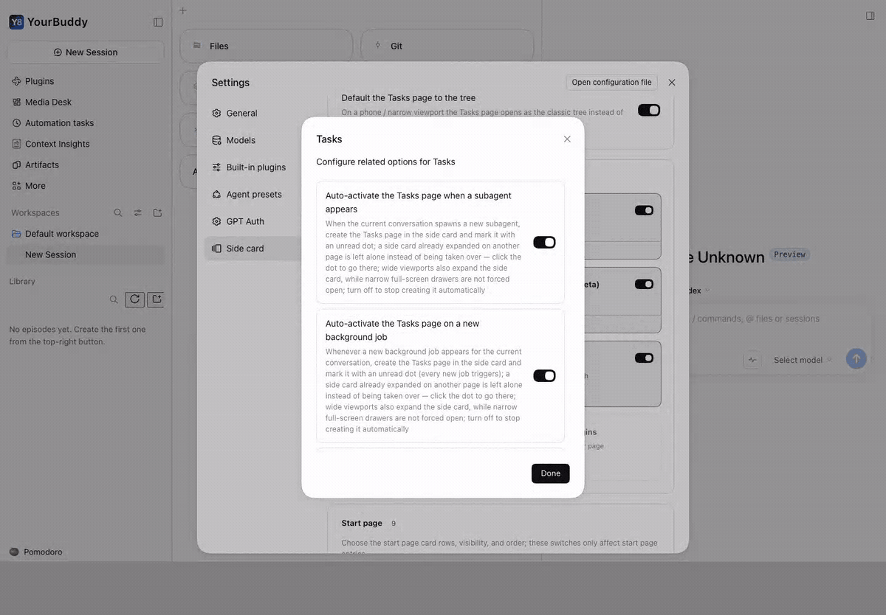
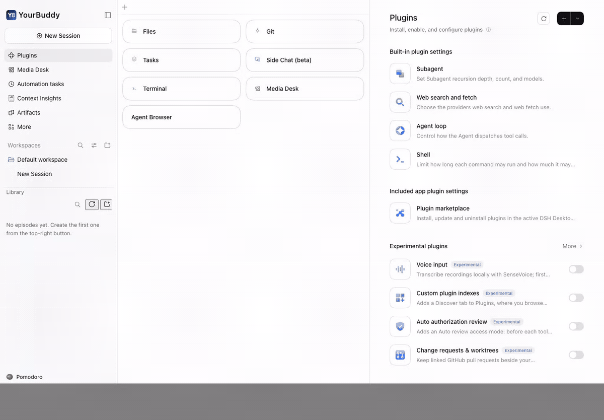
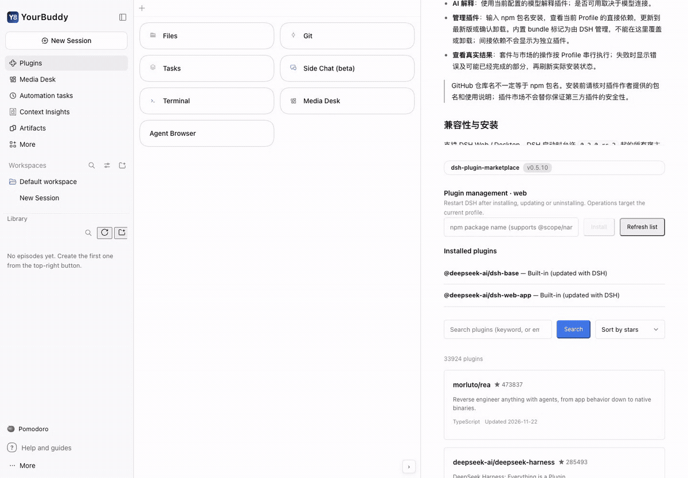
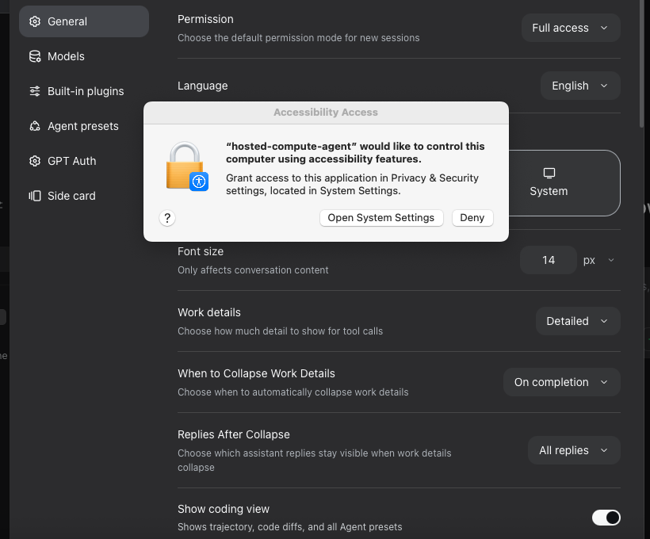

# YourBuddy 0.4.19

English | [中文](README.zh.md)

- Release identifier: `yourbuddy-v0.4.19`, published immutable source tag; GitHub product Release remains absent in the recorded check. Annotated tag object `4ca00c5cd12ebab2543a99249b478842b427e793` peels to `a85a40554ab6f3a5d601023c42153e3c0086770b`.
- Channel: YourBuddy desktop, macOS Apple Silicon.
- Archive state: partial; source archive verified, both formal native attempts failed, installer publication remains blocked.
- Current source: [C34](https://github.com/istarwyh/yourbuddy/commit/c34e3a33e03035971e79ebfa400eb856f8f5a178). PR CI tested synthetic merge `7a6be965dd5389b5011c2071c0bd2694ee932993` of that head into `d7dec019c4e4c72fbac902ceaab9b8bf3ab9acb3`. These are source CI identities, not the tagged version commit a85.
- Evidence gallery: [task settings before](screenshots/tasks-before-on.png), [reopened settings](screenshots/tasks-reopened-off.png), [marketplace entry](screenshots/included-marketplace-entry.png), [configuration](screenshots/marketplace-configuration.png).
- Download: [tag source ZIP](https://github.com/istarwyh/yourbuddy/archive/refs/tags/yourbuddy-v0.4.19.zip) downloaded and extracted with ditto; [tag archive](https://github.com/istarwyh/yourbuddy/tree/yourbuddy-v0.4.19/docs/releases/yourbuddy-v0.4.19) retains frozen prepublication notes. Later observations below are a separate evidence update, not a tag change.

The prepared master is `0f46f5010548ec002575d2803a064c2330c2c11a` (PR #118 merged 2026-11-22 19:06:38 UTC), whose tree `1c93a2791807943a70d9576fd7ec8a9bf6d9ad9c` matches C34. Version preparation occurred afterward; no source CI result below is relabelled as a test of the tagged release commit.

## User release notes

### What changed and problem solved

Saved choices for automatic opening of background-job and subagent panels (`autoOpenJobs`, `autoOpenSubagent`) are no longer replaced by bundled defaults. Plugin Marketplace configuration is reachable again without marking user plugins installed or enabled.

The candidate updates DeepSeek Harness to 0.2.2-rc.5, Cordis to 4.1, Better Sidebar to 0.32.1, Codex Auth to 0.3.4-rc.2, Plugin Marketplace to 0.5.10, Media Desk to 2.7.2 and Context Insights to 0.87. Runtime tools are Node.js 24.22.3 and pnpm 11.28.5; system Node reuse requires 24.9 or later.

### Where and how to try it

Change the task-panel automatic-opening settings, restart the Host and check that your choice persists. Open **Plugins → Included app plugin settings → Plugin marketplace** to configure the bundled marketplace.

### Install, compatibility and limitations

After publication, Bootstrap DMG obtains missing components on demand; Offline DMG carries the same component seeds. Existing installations provide **Settings → General → Application lifecycle → Check for updates**. This draft does not establish an actual current-app upgrade.

Minimum macOS is **13.5 on Apple Silicon**, required by the Node binary. macOS 11/12/13.0–13.4 are not claimed compatible; the complete 13.5 compatibility matrix and every optional tool remain unverified. Windows/Linux/Intel Mac installers are not offered by this channel. Experimental native Codex restrictions remain; updating Harness does not establish support for those capabilities. Real-model calls/account sign-in remain unverified. Tauri updater signing is not Apple Developer signing/notarization. No universal migration or zero-side-effect guarantee is made.

## Verification summary

| Scenario | Status | Build | Evidence |
|---|---|---|---|
| Final Linux source/coverage/artifact consumers | passed; skips retained | C34 PR synthetic merge | [Linux excerpt](evidence/linux-ci.txt) |
| Windows source coverage and Sidebar lifecycle | passed; expected fail/skips retained | Same merge | [Windows excerpt](evidence/windows-ci.txt) |
| Frozen prepared product and real Harbor Profile installation | passed within controlled-bridge scope | Same merge; not DMG | [Prepared excerpt](evidence/prepared-macos.txt) |
| Clean fresh branded product build/install | passed per operator report | Direct clean C34 | [Build record](evidence/clean-product-build.txt) |
| Recorded task choices and Marketplace entry | passed within Web UI scope | Direct C34 production Host with Rust overlay | [UI record](evidence/gui-evidence.json) |
| Node floor and installer fixture history | bounded metadata/fixture evidence only | External binary and earlier local source | Below |
| Native release attempt 1 | failed; stale verifier assertion diagnosed | Tagged a85 Offline application | [Native attempt](evidence/native-attempt-1.txt) |
| Native release attempt 2 | failed; dialog observation timed out, cause unresolved | Same a85 product; trusted merged c2f verifier | [Second attempt](evidence/native-attempt-2.txt) |
| Public source ZIP | passed with ditto; UnZip failures retained | Immutable tagged a85 source | [ZIP evidence](evidence/source-zip.txt) |
| Public installers/updater and website guidance | blocked / pending | No GitHub product Release | Below |

## Scenario: final Linux source and browser consumers

- Status: passed within the following counts; skips remain skips.
- Date/time: 2026-11-22 UTC (+00:00); coverage job 17:09:35–18:22:07, artifacts job 17:09:13–18:39:19.
- Release/commit: `yourbuddy-v0.4.19`; C34 source and synthetic merge identified above. Build: PR source and built browser artifacts, not published product.
- Environment: Ubuntu 26.04.1 LTS, image 20261116.202.1, Node 24.22.3, pnpm 11.28.5; Chromium 149.0.7827.55 and WebKit 26.5 for browser lane.
- Origin/data/services: this final PR CI run; synthetic fixtures and controlled services; not live-provider acceptance.

1. Execute native-system preparation and both coverage gates. 2. Execute artifact build, compatibility, package/layout/type checks, snapshots, built-bin smoke and browser snapshots.

Expected: required gates pass without suppressing failures. Actual: Linux coverage aggregate 3/3 gates passed; coverage subprocess output suppresses exact test/file/skip counts, so these counts are unknown. Artifact consumers 9/9 gates passed. Browser suite: 1,052 tests passed, 25 skipped; 239 files passed, 3 skipped. No historical count is substituted. Final Linux run also completed its lint/static/benchmark/Node compatibility checks successfully according to collected run metadata.

Evidence: [run 45047783952](https://github.com/istarwyh/yourbuddy/actions/runs/45047783952) and relative Linux excerpt. No screenshot quota applies; timestamped results are sufficient for these counts. No recovery is claimed within the successful final run. Limits: source/built-browser acceptance is not signed installer/native authority/public download or real model acceptance. The same-head real DeepSeek workflow [45047783960](https://github.com/istarwyh/yourbuddy/actions/runs/45047783960) was skipped, not passed.

## Scenario: Windows coverage and saved Sidebar choices

- Status: passed for observed source behavior, with expected failure/skips explicitly retained.
- Date/time: 2026-11-22 17:08:56–18:21:37 UTC (+00:00); lifecycle case result at 18:04:08.742303 UTC.
- Release/commit/build: `yourbuddy-v0.4.19`; same C34 synthetic merge; source suite, not a Windows or macOS installer.
- Environment: Windows Server 2025, 10.0.26100 Datacenter, image 20261116.315.1; Node 24.22.3, pnpm 11.28.5.
- Origin/data/services: current PR CI; isolated synthetic configuration/Profile fixtures and real lifecycle processes; not a real model/account or upgrade of the running GUI.

1. Exercise disabled and enabled auto-open preferences through Profile writes and restarts, including a rejected final config override. 2. Run final combined coverage reporting.

Expected: choices survive restarts and the suite satisfies its coverage gate. Actual: lifecycle case passed in 40,608 ms; final combined totals are 53,297 passed, 1 expected fail and 295 skipped tests; 2,564 passed and 29 skipped files. All-files statements/branches/functions/lines are each 100%. Counts are not sums of repeated reporters or preflight runs.

Evidence: [run 45047783929](https://github.com/istarwyh/yourbuddy/actions/runs/45047783929) and relative Windows excerpt; no screenshots needed for source lifecycle totals. Limits: not packaged native WebView or in-place current-app update evidence, and no Windows installer support claim. Earlier local observations are historical only and are not relabelled current C34 passes.

## Scenario: frozen prepared macOS product and installed Harbor

- Status: passed within prepared-product scope.
- Date/time: 2026-11-22 17:08:58–17:29:15 UTC (+00:00); default success 17:26:32.318283; installed phase success 17:28:32.458388.
- Release/commit/build: `yourbuddy-v0.4.19`; same C34 synthetic merge; frozen prepared production install, not tagged DMG.
- Environment: macOS 15.8.2 (24H232), arm64 image 20261118.0550.1; Node 24.22.3, pnpm 11.28.5, Chromium 149.0.7827.55, CPython 3.12.14, Harbor CLI 0.21.0 and harbor-dsh-evolution 0.10.3.
- Origin/data/services: current PR CI; synthetic workspace/isolated Profile; real local Host/Profile/Python; controlled native invoke bridge supplied by the verifier, not packaged Tauri authority or real provider.

1. Prepare frozen distribution inputs and install from the offline production Store. 2. Verify default Clients and document viewing/reopening in Chromium. 3. Install optional Harbor in the real Profile and repeat assembled-product checks.

Expected: materialize the full resolved production graph and activate default/installed Clients with Python readiness. Actual: 607/607 prepared registry inputs and native Codex/Claude SDK executables present; default passed with 11 product Clients, Codex default, lightweight browser and PDF/DOCX/PPTX/XLSX viewing/reopening. Harbor 0.10.3 interpreter/commands ready; real Profile installation passed; installed phase passed with 108 core peer links and 12 assembled product Clients. The linked-peer warning was followed by completed diagnostics and installed-phase success; it is not erased from source logs.

Evidence: [run 45047784001](https://github.com/istarwyh/yourbuddy/actions/runs/45047784001), relative prepared excerpt and retained CI prepared-acceptance artifacts. Captures exist in temporary CI artifacts but are not attached here. Limits: no native packaged controls/permissions, model/account, full OS matrix or current-app upgrade conclusion.

## Scenario: clean C34 branded production build

- Status: passed per owning operator report, with commands and post-build host metadata retained in the evidence record.
- Date/time: 2026-11-22 18:41:10–18:41:53 UTC (+00:00).
- Release/commit/build: `yourbuddy-v0.4.19`; direct C34 `c34e3a33e03035971e79ebfa400eb856f8f5a178`, clean before and after; local freshly built branded product, not synthetic merge or release artifact.
- Environment: macOS 15.6.1 (24G90), arm64, Node 24.22.3, pnpm 11.28.5; host metadata collected afterward at 18:51:51 UTC, not at build start. Origin: current-source main-agent job bash1430; data: build/frozen dependencies; model/service: no live model claim.

1. Build branded production artifacts from the clean source. 2. Perform a fresh frozen production installation and confirm unchanged clean HEAD.

Expected: fresh output builds/installs without source changes. Reported actual: 10 gates passed in 19.22s, 371 client artifacts; bundle SHA-256 `f0b06029fd09481e3df40d958a10bf0abc4a145634dfffea52edd384820eb606`; 607 packages installed in 6.4s; unchanged clean C34 before/after. Evidence: relative build record, explicitly attributed to the operator rather than a newly executed draft-author test. No failure/recovery or screenshot claim. Limits: unsigned local build, no native/public acceptance. The separate real Web UI recording below does not establish native Tauri acceptance.

## Scenario: task choices and Marketplace entry in a real Web UI

- Status: passed for the recorded Web UI journey and separately verified public media attachment.
- Date/time: 2026-11-22 18:50:40.092–18:50:57.240 UTC (+00:00); attachment verification timestamp was not supplied in the bounded operator report.
- Release/commit/build: prepared for `yourbuddy-v0.4.19`; direct C34 source and matching production tree; isolated production Host with genuine Rust-rendered desktop overlay, not the signed application.
- Environment: macOS 15.6.1 arm64, Node 24.22.3, Chrome 157.0.8103.79, private Profile; allocated workspace, not a user-selected workspace.
- Origin/data/services: this candidate's continuous recorded run; synthetic workspace/private Profile; real local Host and passive public GitHub API response; no model/provider, fake HTTP, native invoke stub or ledger injection.

1. Observe both automatic-opening switches enabled, turn both off, and close the entire Settings dialog. 2. Reopen Settings and verify both remain off. 3. Open Plugins, Included app plugin settings, Plugin marketplace, and retain the real configuration view through the final hold.

Expected: reopened settings retain the chosen values and the restored Marketplace entry opens the real configuration. Actual: all recorded states observed; no page/console errors, failed requests or HTTP errors; initial public GitHub query returned 200, loading was false at the end, heading and input stayed at equal rectangles through the last three seconds. No plugin was installed or search explicitly submitted.

Evidence: [sanitized UI record](evidence/gui-evidence.json) and [public recording attached to PR #118](https://github.com/user-attachments/assets/7df4ce13-9402-49bc-b69e-295218e2a03c). The operator verified anonymous HTTP 200, `image/gif`, 8,718,514 bytes, SHA-256 `63e30385130acf385f6f0dc8535d936f93606f44d66b052db4d1673b9cbf035e`, and rendered GitHub Markdown. The continuous GIF is 20.76s, 166 frames, 1200×834, 8fps, 96 colors, 1× speed with a three-second final hold. No failed take or raw recording is included.

Limits: Web transport, not native Tauri UI/Runtime Authority; Settings reopen persistence, not Host restart or in-place application upgrade. Official directory-picker overlay was present but unused. Repository Playwright and isolated system Chrome were used because Ego CLI was unavailable. Passive public results do not establish installation, search submission or third-party plugin correctness.

## Platform floor and historical fixture incident

Node metadata inspection passed on 2026-11-22 21:44:33 UTC+08:00 (Asia/Shanghai): external Node.js 24.22.3 darwin-arm64 binary SHA-256 `ba7073582822078d8c90bca3facacc46690bc5366fab4b815aeef9148cd6e854`, Mach-O minimum 13.5, SDK 15.0. Actions: read version/hash and inspect `LC_BUILD_VERSION`; expected/actual: determine the true runtime minimum. Source is the earlier bounded collector record, not a C34 full-system test; host OS metadata is absent, model/service not applicable. Full 13.5 compatibility is not established.

Historical local final installer fixtures reported 17/17 passing, including early system-floor refusal and synthetic accepted receipts in private environments/app targets. The bounded log lacks exact commit, clock time and host metadata; it is not a current C34 or real native installer pass. An earlier fixture execution selected the real installed helper and wrote seven installer-operation records and related files. Signature rejection occurred before component preparation, replacement or stopping the application; the operator separately observed the existing GUI had not restarted. The audit did not remove user files or establish that all user files were unchanged. The fixture repair isolated environment roots and every explicit app target. This sanitized incident summary preserves the failure and repair without raw JSON/private paths; original local records remain retained, not publicly attached.

## Scenario: failed native release attempt 1

- Status: failed; diagnosis does not retrospectively convert the run to passed.
- Date/time: 2026-11-22 19:54:00.043116–19:56:20.412602 UTC (+00:00), native acceptance step; the release operator reported a 33m15s overall job duration.
- Release/commit/build: `yourbuddy-v0.4.19`, immutable product `a85a40554ab6f3a5d601023c42153e3c0086770b`; newly built Offline app, not C34 source CI or a public installer.
- Environment: GitHub Actions macOS arm64, aarch64-apple-darwin, Node 24.22.3; precise native runner OS version was not collected in this bounded evidence and is not borrowed from earlier CI.
- Origin/data/services: first tagged release run; isolated synthetic native acceptance Profile; real local Host and native AX observations, no model/provider or user-account acceptance.

1. Build the tagged prepared product, components, Bootstrap package/ceiling and Offline app. 2. Start native Offline acceptance, authenticate the real Host, acknowledge the actual Preview Notice and inspect the owned main window through AX.

Expected: recognize the authenticated workbench, exercise Settings and complete the remaining cold-start/lifecycle checks before publication. Actual: Host authenticated readiness and boot completed; final screenshot/AX showed Account menu, Codex popup and composer, with Preview Notice absent. Thirteen complete AX samples reported zero skipped nodes. The verifier still required a direct root Settings control alongside Codex, although Settings now belongs inside Account menu. The step ended with condition unmet and exit 1. Native Settings navigation, two later cold starts and relocation were not completed. Prepared/component/Bootstrap-ceiling/Offline build success does not make the whole workflow green; asset staging, updater/checksums and publication remained blocked.

Evidence: [failed run 45060471500](https://github.com/istarwyh/yourbuddy/actions/runs/45060471500) and [sanitized attempt record](evidence/native-attempt-1.txt). Intermediate recoverable AX errors are not substituted for the final complete evidence. At 20:01:27 UTC the release-by-tag API returned 404 while an independent repository lookup succeeded.

Recovery/limits: the verifier-only correction reached merged master and the new existing-tag dispatch below preserved unchanged product a85 and separate application/verifier identities. This original run remains failed. Product changes require a new version; do not move this tag. Complete Settings/native command authority and subsequent lifecycle/public checks remain unverified.

## Scenario: failed native release attempt 2

- Status: failed at scoped Settings observation; publication was skipped.
- Date/time: 2026-11-23 00:59:43–01:02:04 UTC (+00:00), native acceptance step.
- Release/commit/build: immutable `yourbuddy-v0.4.19` product a85; trusted workflow/verifier `c2f39b75f8d2810f2fb296b959bf69a4735587ba`, after PRs #120/#121 merged through official stack 122. Newly built Offline app, not a public installer.
- Environment/origin/data/services: GitHub Actions `macos-15` arm64, exact OS/image version unrecorded; this existing-tag run, isolated synthetic Profile, real local Host/native AX, no real model/account acceptance.

1. Build the unchanged tagged product and pass prepared workbench/Harbor, components and both package builds. 2. Authenticate the native Host, open Account menu and press Settings. 3. Observe the named dialog before closing it and completing three cold boots.

Expected: actionable General/Close controls and subsequent native lifecycle checks. Actual: Settings opened, but dialog inspection ended with `osascript ETIMEDOUT`. The last complete account-menu snapshot has 131 rows; no completed dialog assertion, Settings close, second/third boot or result exists. Relocation, updater/checksums and publication were skipped. A fresh authenticated release-by-tag request returned HTTP 404 at 01:17:29 UTC.

Evidence: [run 45089007191](https://github.com/istarwyh/yourbuddy/actions/runs/45089007191), [sanitized record and verified artifact digest](evidence/native-attempt-2.txt), and the actual cropped failure capture below. Artifact 14782160008 contains ten inspected files. The capture was taken after observation failure: it shows an Accessibility Access prompt for `hosted-compute-agent`, not when that prompt appeared or whether it caused the timeout.

Limits/recovery: the blocking AppleEvent and root cause remain unknown. Static query-stage diagnostics can locate a later failure; they do not establish recovery. The 15-second subprocess and shared 60-second observation budgets, existing-permission requirement, unique targets and unchanged product tag remain mandatory. Visible Settings and historical 0.4.17 passes do not establish complete 0.4.19 native acceptance.

## Scenario: public tagged source ZIP

- Status: passed for anonymous download, ditto extraction and inspected source archive; two Apple UnZip extraction failures retained.
- Date/time: download 2026-11-22 19:24:55–19:25:08 UTC (+00:00); extraction/content review completed 19:29:21 UTC.
- Release/commit/build: `yourbuddy-v0.4.19`, source `a85a40554ab6f3a5d601023c42153e3c0086770b`; public source ZIP, not an installed binary.
- Environment: local macOS native ditto and Apple Info-ZIP UnZip 6.00; exact host OS version not present in the bounded record. Origin: this release's source-download review; data: public source/sanitized archive; services: anonymous GitHub HTTP, no model or executed product.

1. Download the immutable source ZIP and record content type, size, hash and ZIP comment. 2. Fully extract with ditto, compare the 12 tagged archive files byte-for-byte, read both notes/pair/five evidence records and open all four PNGs. 3. Inspect extracted desktop/Tauri/Cargo version metadata.

Expected: source archive identifies the tag and contains readable evidence. Actual: HTTP 200, application/zip, 95,823,429 bytes; SHA-256 `076be1776090e01d929985e71b216ec500ad8498e6e1ba93db69331fb66154fa`; ZIP comment a85; all 12 archive files matched. Both notes and four 1200×834 screenshots opened; version sources read 0.4.19 and Tauri minimum 13.5. Apple UnZip under inherited C and explicit UTF-8 locales both failed on a Chinese filename with exit 50 despite 336 GiB free; ditto fully extracted the identical ZIP. This is not universal extractor compatibility.

Evidence: [sanitized source ZIP record](evidence/source-zip.txt). The tagged notes intentionally remain their frozen prepublication version, not these later observations. Limits: no extracted code/app executed; no installer, native authority, signature/updater, real provider, current-app upgrade or website acceptance. Later evidence is committed separately without moving the tag.

## Delivery status

- Product publication: blocked by both failed native attempts. The source tag and verified source ZIP exist; the release-by-tag API still returned 404 after attempt 2. Neither failed run published public installers or the stable updater.
- Verification archive: partial, with reviewed GUI media, C34 source evidence, both failed native attempts and verified tagged source ZIP. Tagged notes remain frozen prepublication; later observations use separate evidence updates. Successful complete native acceptance and public installer/update verification remain outstanding.
- Website synchronization: changed guidance is prepared in Draft PR #123, held until product publication and public-asset verification. Earlier recorded deployment [43875873457](https://github.com/istarwyh/yourbuddy/actions/runs/43875873457) is not evidence for this guidance. Actual follow-up deployment and live bilingual verification remain pending.
- Unverified scope: skipped/expected-fail tests as counted; real DeepSeek/provider/account; complete native Settings/Runtime Authority/controls, two later cold starts and relocation; public installer assets/hashes/signatures/updater; actual old-version in-place upgrade/restart/conversation restoration; complete macOS 13.5/optional-tool matrix. Historical local proof remains historical. Other package publication channels are not applicable.

## Delivery checklist

- [x] Attribute current C34 source, synthetic PR merge, test counts/skips and prepared bridge limits accurately.
- [x] Keep historical floor/fixture incident separate and exclude private paths/operation JSON.
- [ ] Confirm tagged bilingual archive/pair/index, reviewed relative evidence and final immutable evidence links.
- [x] Download and inspect the immutable source ZIP; retain extractor failures and ditto success.
- [ ] Complete native recovery and verify public installers/updater independently, not just source CI.
- [ ] Record website deployment/live checks and independent four-part delivery status without moving public tags or replacing installers.
