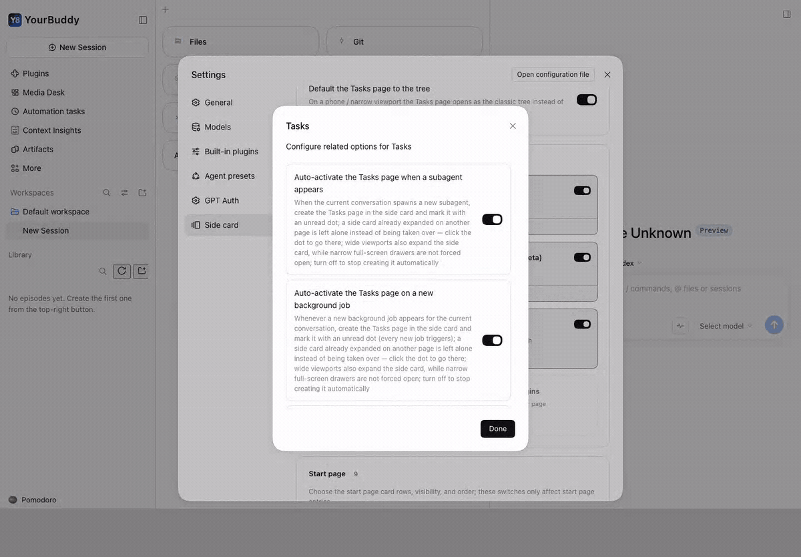
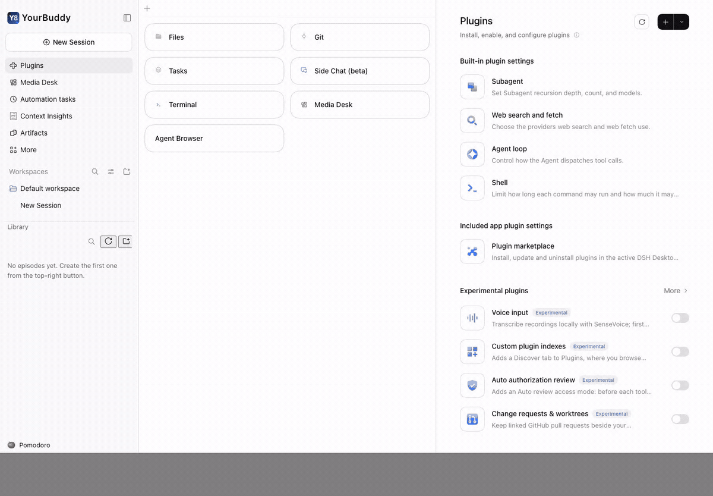
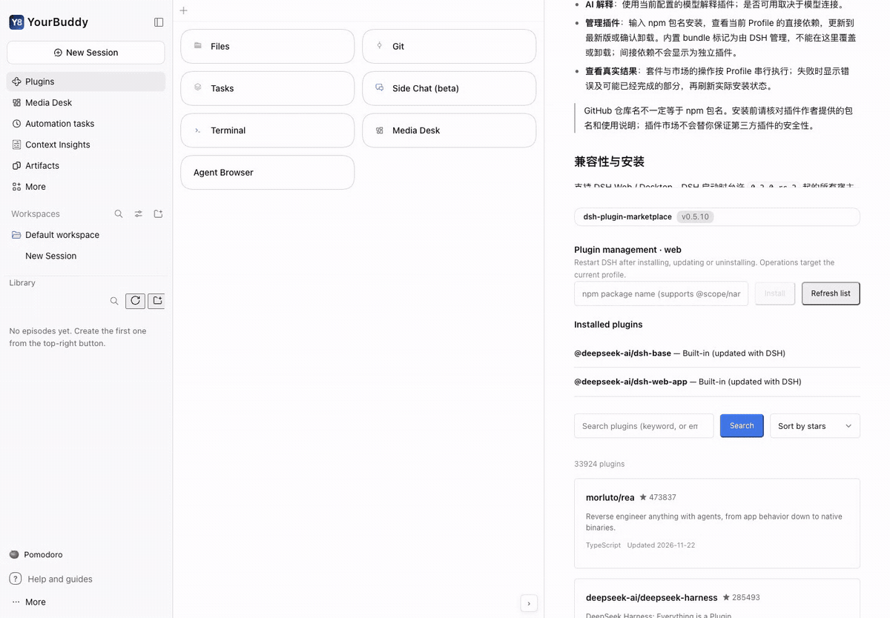

# YourBuddy 0.4.19

[English](README.md) | 中文

- 发布标识：`yourbuddy-v0.4.19`，已公开且不可变的源码标签；所记录检查中 GitHub 产品 Release 仍不存在。注解标签对象 `4ca00c5cd12ebab2543a99249b478842b427e793` 解引用至 `a85a40554ab6f3a5d601023c42153e3c0086770b`。
- 渠道：YourBuddy 桌面应用，macOS Apple Silicon。
- 归档状态：部分完成；源码归档已验证，首次正式原生验收失败，安装包发布仍受阻。
- 当前源码：[C34](https://github.com/istarwyh/yourbuddy/commit/c34e3a33e03035971e79ebfa400eb856f8f5a178)。PR CI 测试其合入 `d7dec019c4e4c72fbac902ceaab9b8bf3ab9acb3` 的合成提交 `7a6be965dd5389b5011c2071c0bd2694ee932993`。二者是源码 CI 身份，不是标签版本提交 a85。
- 证据图集：[任务设置操作前](screenshots/tasks-before-on.png)、[重新打开设置](screenshots/tasks-reopened-off.png)、[市场入口](screenshots/included-marketplace-entry.png)、[配置界面](screenshots/marketplace-configuration.png)。
- 下载：[标签源码 ZIP](https://github.com/istarwyh/yourbuddy/archive/refs/tags/yourbuddy-v0.4.19.zip)已下载并用 ditto 解压；[标签归档](https://github.com/istarwyh/yourbuddy/tree/yourbuddy-v0.4.19/docs/releases/yourbuddy-v0.4.19)保留冻结的发布前说明。下文后续观察属于独立证据更新，不修改标签。

准备后的 master 为 `0f46f5010548ec002575d2803a064c2330c2c11a`（PR #118 于 2026-11-22 19:06:38 UTC 合并），其树 `1c93a2791807943a70d9576fd7ec8a9bf6d9ad9c` 与 C34 相同。版本准备在此之后进行；下文不把源码 CI 结果重标为实际发布标签提交的测试。

## 用户发行说明

### 改动及解决的问题

后台任务和子代理面板自动打开选项（`autoOpenJobs`、`autoOpenSubagent`）不再被随应用提供的默认配置替换。插件市场配置入口恢复，不把用户插件标记为已安装或已启用。

候选版本更新 DeepSeek Harness 至 0.2.2-rc.5、Cordis 至 4.1、Better Sidebar 至 0.32.1、Codex Auth 至 0.3.4-rc.2、Plugin Marketplace 至 0.5.10、Media Desk 至 2.7.2、Context Insights 至 0.87。运行工具为 Node.js 24.22.3、pnpm 11.28.5；复用系统 Node 至少需要 24.9。

### 在哪里及如何体验

修改任务面板自动打开选项，重启 Host 后检查保存值；通过 **插件 → 随应用提供的插件设置 → 插件市场** 配置随应用提供的插件市场。

### 安装、兼容性与限制

发布后，Bootstrap DMG 按需获取缺失组件；Offline DMG 提供相同组件的离线种子。已有安装提供 **设置 → 通用 → 应用生命周期 → 检查更新**。本草稿不证明当前应用已实际升级。

最低系统为 **macOS 13.5、Apple Silicon**，依据必需 Node 二进制下限。不宣称兼容 macOS 11/12/13.0–13.4；完整 13.5 兼容矩阵及全部可选工具仍未验证。本渠道不提供 Windows/Linux/Intel Mac 安装包。实验性原生 Codex 限制保留；升级 Harness 不建立这些能力已受支持的结论。真实模型及账户登录未验证。Tauri 更新签名不等于 Apple Developer 签名或公证。不作普遍迁移或零副作用保证。

## 验证摘要

| 场景 | 状态 | 构建 | 证据 |
|---|---|---|---|
| 最终 Linux 源码、覆盖率及产物消费者 | passed；保留跳过项 | C34 PR 合成合并提交 | [Linux 摘录](evidence/linux-ci.txt) |
| Windows 源码覆盖率及 Sidebar 生命周期 | passed；保留预期失败及跳过 | 同一合并提交 | [Windows 摘录](evidence/windows-ci.txt) |
| 冻结准备后产品及真实 Harbor Profile 安装 | 受控桥接范围内 passed | 同一合并提交；非 DMG | [准备后产品摘录](evidence/prepared-macos.txt) |
| clean 源码全新品牌生产构建及安装 | 操作者报告 passed | 直接 clean C34 | [构建记录](evidence/clean-product-build.txt) |
| 任务选项及插件市场入口录制 | Web UI 范围内 passed | 直接 C34 生产 Host 配合 Rust overlay | [UI 记录](evidence/gui-evidence.json) |
| Node 系统下限及安装器夹具历史 | 仅有界元数据及夹具证据 | 外部二进制及较早本地源码 | 下文 |
| 首次原生发布验收 | failed；已诊断过期 verifier 断言 | 标签 a85 Offline 应用 | [原生尝试](evidence/native-attempt-1.txt) |
| 公开源码 ZIP | ditto passed；保留 UnZip 失败 | 不可变标签 a85 源码 | [ZIP 证据](evidence/source-zip.txt) |
| 公开安装包、更新源及网站指引 | 受阻／待完成 | 无 GitHub 产品 Release | 下文 |

## 场景：最终 Linux 源码与浏览器消费者

- 状态：以下统计范围内 passed；跳过仍为跳过。
- 日期时间：2026-11-22 UTC（+00:00）；coverage job 为 17:09:35–18:22:07，产物 job 为 17:09:13–18:39:19。
- 发布及提交：`yourbuddy-v0.4.19`；上文 C34 源码及合成提交。构建为 PR 源码及浏览器构建产物，不是公开产品。
- 环境：Ubuntu 26.04.1 LTS，镜像 20261116.202.1，Node 24.22.3、pnpm 11.28.5；浏览器阶段 Chromium 149.0.7827.55、WebKit 26.5。
- 来源、数据及服务：最终 PR CI；模拟夹具及受控服务，不是真实服务商验收。

1. 执行原生系统准备及两项覆盖率 gate。2. 执行产物构建、兼容性、包和布局和类型检查、快照、构建后 bin smoke 及浏览器快照。

预期：必需检查通过且不屏蔽失败。实际：Linux coverage 聚合 3/3 gate 通过；成功子进程输出隐藏，因此精确测试、文件和平台跳过数未知。产物消费者 9/9 gate 通过。浏览器套件 1,052 项测试通过、25 跳过；239 个文件通过、3 跳过。不套用历史计数。采集的最终 Linux run 元数据还确认 lint、static、benchmark、Node 兼容检查成功。

证据：[执行 45047783952](https://github.com/istarwyh/yourbuddy/actions/runs/45047783952)及相对 Linux 摘录。此类计数无需截图配额，带时间戳结果足够；不宣称最终成功执行中发生过恢复。限制：源码及浏览器构建验收不等于签名安装包、原生权限、公开下载或真实模型验收。同 head 的真实 DeepSeek [执行 45047783960](https://github.com/istarwyh/yourbuddy/actions/runs/45047783960)为 skipped，不是 passed。

## 场景：Windows 覆盖率及 Sidebar 保存选项

- 状态：已观察源码行为 passed，明确保留预期失败和跳过项。
- 日期时间：2026-11-22 17:08:56–18:21:37 UTC（+00:00）；生命周期用例结果为 18:04:08.742303 UTC。
- 发布、提交及构建：`yourbuddy-v0.4.19`；同一 C34 合成提交；源码套件，不是 Windows 或 macOS 安装包。
- 环境：Windows Server 2025、10.0.26100 Datacenter，镜像 20261116.315.1；Node 24.22.3、pnpm 11.28.5。
- 来源、数据及服务：当前 PR CI；隔离模拟配置/Profile 夹具和真实生命周期进程；不是真实模型、账户或当前运行 GUI 升级。

1. 通过 Profile 写入和重启检查禁用及启用自动打开选项，并拒绝最终配置覆盖。2. 执行最终合并覆盖率报告。

预期：选项在重启后保留，套件满足覆盖率要求。实际：生命周期用例 40,608 ms 通过；最终合并计数为 53,297 passed、1 expected fail、295 skipped；文件 2,564 passed、29 skipped。All-files 的 statements、branches、functions、lines 均为 100%。未累加重复 reporter 或 preflight 数量。

证据：[执行 45047783929](https://github.com/istarwyh/yourbuddy/actions/runs/45047783929)及相对 Windows 摘录；源码生命周期计数无需截图。限制：不是打包原生 WebView 或当前应用原地升级证据，也不宣称提供 Windows 安装包。较早本地观察仅为历史，不重标为当前 C34 通过。

## 场景：冻结准备后 macOS 产品及已安装 Harbor

- 状态：准备后产品范围内 passed。
- 日期时间：2026-11-22 17:08:58–17:29:15 UTC（+00:00）；默认阶段成功 17:26:32.318283，安装后阶段成功 17:28:32.458388。
- 发布、提交及构建：`yourbuddy-v0.4.19`；同一 C34 合成提交；冻结准备后生产安装，非标签 DMG。
- 环境：macOS 15.8.2（24H232），arm64 镜像 20261118.0550.1；Node 24.22.3、pnpm 11.28.5、Chromium 149.0.7827.55、CPython 3.12.14、Harbor CLI 0.21.0、harbor-dsh-evolution 0.10.3。
- 来源、数据及服务：当前 PR CI；模拟工作区和隔离 Profile；真实本地 Host/Profile/Python；verifier 提供受控 native invoke 桥接，不是打包 Tauri 权限或真实服务商。

1. 准备冻结发行输入，从离线生产 Store 安装。2. 在 Chromium 验证默认 Client 及文档查看和重新打开。3. 在真实 Profile 安装可选 Harbor，再检查组装产品。

预期：安装完整已解析生产依赖图，使默认及安装后 Client 激活且 Python 就绪。实际：607/607 准备后 registry 输入及原生 Codex/Claude SDK 可执行文件存在；默认阶段通过，含 11 个产品 Client、Codex 默认项、轻量浏览器，以及 PDF/DOCX/PPTX/XLSX 查看和重新打开。Harbor 0.10.3 解释器及命令就绪；真实 Profile 安装成功；安装后阶段通过，含 108 个核心 peer 链接、12 个组装产品 Client。链接 peer 警告之后诊断完成且安装后阶段成功，未从原始日志抹去警告。

证据：[执行 45047784001](https://github.com/istarwyh/yourbuddy/actions/runs/45047784001)、相对准备后产品摘录及保留的 CI prepared-acceptance 产物。临时 CI 产物有截图，此处尚未附。限制：不验证打包原生控件及权限、模型及账户、完整系统矩阵或当前应用升级。

## 场景：clean C34 品牌生产构建

- 状态：负责人报告 passed，证据记录保留命令及构建后采集的主机元数据。
- 日期时间：2026-11-22 18:41:10–18:41:53 UTC（+00:00）。
- 发布、提交及构建：`yourbuddy-v0.4.19`；直接 C34 `c34e3a33e03035971e79ebfa400eb856f8f5a178`，前后 clean；本地全新品牌构建，不是合成提交或发行产物。
- 环境：macOS 15.6.1（24G90）、arm64、Node 24.22.3、pnpm 11.28.5；主机元数据于之后 18:51:51 UTC 采集，并非构建开始时间。来源为当前源码主代理 job bash1430；数据为构建及冻结依赖；不作真实模型服务声明。

1. 从 clean 源码构建品牌生产产物。2. 全新冻结生产安装，并确认 HEAD 未变且仍 clean。

预期：全新输出可以构建和安装，不改变源码。报告实际：10 gate 在 19.22s 内通过，371 个 Client 产物；bundle SHA-256 为 `f0b06029fd09481e3df40d958a10bf0abc4a145634dfffea52edd384820eb606`；607 个包安装耗时 6.4s；前后为同一 clean C34。证据为相对构建记录，明确归于操作者报告，而不是草稿作者新执行测试。不宣称失败恢复或截图。限制：本地未签名构建，不是原生或公开验收。下文独立真实 Web UI 录制不建立原生 Tauri 验收结论。

## 场景：真实 Web UI 中的任务选项及市场入口

- 状态：已录制 Web UI 路径及单独核验的公开媒体附件 passed。
- 日期时间：2026-11-22 18:50:40.092–18:50:57.240 UTC（+00:00）；有界操作者报告未提供附件验证时间戳。
- 发布、提交及构建：为 `yourbuddy-v0.4.19` 准备；直接 C34 源码及相同生产树；隔离生产 Host 配合真实 Rust 生成的桌面 overlay，不是签名应用。
- 环境：macOS 15.6.1 arm64、Node 24.22.3、Chrome 157.0.8103.79、私有 Profile；分配的工作区，非用户选择的工作区。
- 来源、数据及服务：本候选版本连续录制；模拟工作区及私有 Profile；真实本地 Host 及被动公共 GitHub API 响应；没有模型服务商、伪造 HTTP、native invoke stub 或账本注入。

1. 观察两项自动打开开关均开启，将两项关闭，再关闭整个设置对话框。2. 重新打开设置，确认两项仍关闭。3. 打开插件、随应用提供的插件设置、插件市场，保持真实配置界面至最终停留结束。

预期：重新打开设置后保留选择，恢复的市场入口打开真实配置。实际：观察到全部录制状态；page/console errors、request failures、HTTP errors 均为空；初始公共 GitHub 查询返回 200，结束时 loading 为 false，最后三秒内标题及输入框矩形位置相同。未安装插件或显式提交搜索。

证据：[脱敏 UI 记录](evidence/gui-evidence.json)及[已附入 PR #118 的公开录制](https://github.com/user-attachments/assets/7df4ce13-9402-49bc-b69e-295218e2a03c)。操作者确认匿名 HTTP 200、`image/gif`、8,718,514 字节、SHA-256 `63e30385130acf385f6f0dc8535d936f93606f44d66b052db4d1673b9cbf035e`，并核验 GitHub Markdown 渲染。连续 GIF 为 20.76s、166 帧、1200×834、8fps、96 色、1× 速度，最终停留三秒。不包含失败录制或原始录像。

限制：Web 传输，不是原生 Tauri UI 或 Runtime Authority；仅设置重新打开持久性，不是 Host 重启或应用原地升级。官方目录选择器 overlay 存在但未使用。Ego CLI 不可用，因此使用仓库 Playwright 及隔离系统 Chrome。被动公共结果不建立安装、搜索提交或第三方插件正确性的结论。

## 系统下限及历史夹具事件

Node 元数据检查于 2026-11-22 21:44:33 UTC+08:00（Asia/Shanghai）通过：外部 Node.js 24.22.3 darwin-arm64 二进制 SHA-256 为 `ba7073582822078d8c90bca3facacc46690bc5366fab4b815aeef9148cd6e854`，Mach-O minimum 13.5、SDK 15.0。操作为读取版本和哈希及检查 `LC_BUILD_VERSION`；预期及实际为确定运行时真实下限。来源为较早有界采集记录，不是 C34 整体系统测试；缺主机系统元数据，模型服务不适用。不建立完整 13.5 兼容结论。

历史本地最终安装器夹具报告 17/17 通过，包含提前拒绝系统下限和在私有环境及应用目标下接受模拟回执。有界日志缺精确提交、时间及主机元数据，不视作当前 C34 或真实原生安装器通过。更早的夹具执行选中真实已安装 helper，写入七条安装器操作记录及相关文件。签名拒绝先于组件准备、替换或停止应用；操作者另行观察既有 GUI 未重启。审计未删除用户文件，也不证明所有用户文件未变。夹具已隔离环境根及全部显式应用目标。本脱敏摘要保留失败及修复，不含原始 JSON 或私有路径；原本地记录仍保留，未公开附入。

## 场景：首次原生发布验收失败

- 状态：failed；诊断不把实际失败执行追溯改成 passed。
- 日期时间：2026-11-22 19:54:00.043116–19:56:20.412602 UTC（+00:00），原生验收步骤；发布操作者报告整个 job 耗时 33m15s。
- 发布、提交及构建：`yourbuddy-v0.4.19`，不可变产品 `a85a40554ab6f3a5d601023c42153e3c0086770b`；新构建 Offline 应用，不是 C34 源码 CI 或公开安装包。
- 环境：GitHub Actions macOS arm64、aarch64-apple-darwin、Node 24.22.3；有界证据未采集原生 runner 精确系统版本，不借用较早 CI 版本。
- 来源、数据及服务：首次标签发布执行；隔离模拟原生验收 Profile；真实本地 Host 和原生 AX 观察，无模型服务商或用户账户验收。

1. 构建标签准备后产品、组件、Bootstrap 包及体积上限检查、Offline 应用。2. 开始原生 Offline 验收，认证真实 Host，通过实际 Preview Notice，再用 AX 检查所属主窗口。

预期：识别已认证工作台，操作设置并完成后续冷启动及生命周期检查后再发布。实际：Host 认证就绪及启动完成；最终截图和 AX 显示 Account menu、Codex popup、编辑框，Preview Notice 已消失。十三份完整 AX 采样均为零跳过节点。verifier 仍要求 Codex 同级根窗口直接存在 Settings，但当前 Settings 属于 Account menu 内部。步骤最终 condition unmet、exit 1。原生设置导航、后续两次冷启动及 relocation 未完成。准备后产品、组件、Bootstrap 上限及 Offline 构建成功不代表整体工作流全绿；资产暂存、更新源、校验值及发布仍受阻。

证据：[失败执行 45060471500](https://github.com/istarwyh/yourbuddy/actions/runs/45060471500)及[脱敏尝试记录](evidence/native-attempt-1.txt)。中间可恢复 AX 错误不代替最终完整证据。20:01:27 UTC，按标签查询 Release 的 API 返回 404，而独立仓库查询成功。

恢复及限制：严格限于 verifier 的修复可从可信 master 发起新的 existing-tag dispatch，保留标签产品 a85 不变、应用和 verifier 身份分开、重新检查 Release 不存在。此处未记录修复 verifier 的测试、dispatch 或成功恢复。产品变更必须新版本，不移动本标签。完整设置及原生命令权限、后续生命周期和公开检查仍未验证。

## 场景：公开标签源码 ZIP

- 状态：匿名下载、ditto 解压及源码归档检查 passed；保留两次 Apple UnZip 解压失败。
- 日期时间：下载 2026-11-22 19:24:55–19:25:08 UTC（+00:00）；解压及内容审阅于 19:29:21 UTC 完成。
- 发布、提交及构建：`yourbuddy-v0.4.19`，源码 `a85a40554ab6f3a5d601023c42153e3c0086770b`；公开源码 ZIP，不是已安装二进制。
- 环境：本地 macOS 原生 ditto 和 Apple Info-ZIP UnZip 6.00；有界记录未包含精确主机系统版本。来源为本次发布源码下载审阅；数据为公开源码及脱敏归档；服务为匿名 GitHub HTTP，无模型或已执行产品。

1. 下载不可变源码 ZIP，记录内容类型、大小、哈希及 ZIP comment。2. 用 ditto 完整解压，逐字节比较标签内十二个归档文件，读取双语说明、配对及五份证据，打开四张 PNG。3. 检查解压后的 desktop、Tauri、Cargo 版本元数据。

预期：源码归档标识标签并包含可读证据。实际：HTTP 200、application/zip、95,823,429 字节；SHA-256 `076be1776090e01d929985e71b216ec500ad8498e6e1ba93db69331fb66154fa`；ZIP comment 为 a85；十二个归档文件均一致。两篇说明及四张 1200×834 截图已打开；版本源为 0.4.19，Tauri minimum 为 13.5。Apple UnZip 在继承 C 和显式 UTF-8 locale 下均因中文文件名 exit 50，当时仍有 336 GiB 空间；相同 ZIP 由 ditto 完整解压。不作通用解压器兼容保证。

证据：[脱敏源码 ZIP 记录](evidence/source-zip.txt)。标签说明有意保持冻结的发布前版本，不包含后续观察。限制：未执行解压代码或应用；不是安装器、原生权限、签名及更新源、真实服务商、当前应用升级或网站验收。后续证据独立提交，不移动标签。

## 交付状态

- 产品发布：受首次原生验收失败阻塞。源码标签及已验证源码 ZIP 存在，但未观察到 0.4.19 GitHub 产品 Release、公开安装包或稳定更新源；整体工作流失败。
- 验证归档：部分完成，包含已审查 GUI 媒体、C34 源码证据、失败原生尝试及已验证标签源码 ZIP。标签说明仍为冻结发布前版本；后续观察属于此次独立证据更新。完整原生验收成功及公开安装包和更新验证仍待完成。
- 网站同步：变更指引仍待同步。现有部署仍为较早网站版本（55b），最近成功执行为 [43875873457](https://github.com/istarwyh/yourbuddy/actions/runs/43875873457)；更新指引需要后续部署及双语线上验证，不宣称当前已同步。
- 未验证范围：已计数的跳过及预期失败；真实 DeepSeek/服务商/账户；完整原生 Settings、Runtime Authority 及控件、后续两次冷启动及 relocation；公开安装包资产及哈希和签名及更新源；旧版真实原地升级、重启及会话恢复；完整 macOS 13.5 及可选工具矩阵。较早本地证据仍为历史。其他包发布渠道不适用。

## 交付清单

- [x] 准确归属当前 C34 源码、PR 合成提交、测试计数及跳过、准备后桥接限制。
- [x] 独立保留历史系统下限及夹具事件，不含私有路径和操作 JSON。
- [ ] 确认标签内双语归档、配对、索引、已审查相对证据及最终不可变证据链接。
- [x] 下载并检查不可变源码 ZIP，保留解压器失败及 ditto 成功。
- [ ] 完成原生恢复，独立验证公开安装包及更新源，而不仅是源码 CI。
- [ ] 记录网站部署及线上检查，独立更新四项交付状态，不移动公开标签或替换安装包。
